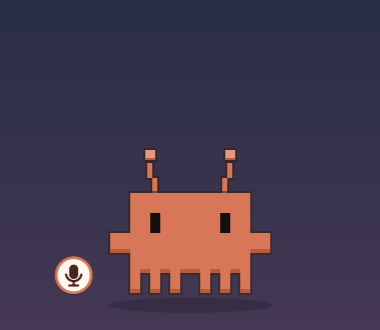

# Klawdy

**A pixel-art desktop companion for [Claude Code](https://docs.claude.com/claude-code).**
Klawdy floats on your desktop and shows what Claude is doing — working, needs you, done — so you can look away
from the terminal. It also gives you a quick prompt box (`Ctrl+.`), a menu for skills, MCP servers and past
conversations, and optional offline voice commands.



> **Unofficial community project.** Klawdy is not made, endorsed or supported by Anthropic.
> Claude and Claude Code are trademarks of Anthropic, PBC.
>
> 🇧🇷 [Leia em português](README.md)

## Features

- **Status at a glance** — Klawdy walks and types while Claude works, waves and glows when Claude needs your
  approval (with a desktop notification), celebrates when it's done and falls asleep when idle.
- **Jump to the session** — click Klawdy to bring that conversation's terminal to the front (GNOME).
- **Named sessions** — every conversation shows Claude's title (or your own name for it) instead of the folder name.
  Open any conversation's history in a new terminal from the menu.
- **`Ctrl+.` prompt box** — ask something without switching windows; send it to an open conversation, a past one,
  a new terminal or a background run. The answer shows in a bubble (click it to read it all; it hides after 30 s).
- **Skills menu** — every skill you have (Claude Code built-ins, claude.ai, plugins, `~/.claude/skills`), grouped.
  While a skill runs Klawdy goes **viking**: helmet always, sword for skills that build/fix, shield for skills that
  review/protect.
- **MCP servers menu** — status of each server, turn them on/off for new conversations, log in to the ones that need it.
- **Looks** — colour themes, optional costumes and background scenery, size 100–350 px (mouse wheel).
- **Voice (optional, offline)** — say "Klawdy, open my Downloads folder" or click the mic button.
- **Settings window**, English and Portuguese, light on CPU when idle.

## Requirements

| | |
|---|---|
| OS | Linux with X11 or Wayland (Klawdy runs through XWayland on Wayland) |
| Desktop | **GNOME 45–50**: everything. **KDE, Xfce, others**: everything except jumping to a session's terminal and the automatic `Ctrl+.` shortcut (you can bind `~/.local/share/klawdy/prompt.sh` yourself) |
| Claude Code | Tested with **2.1.322** (see [Compatibility](#compatibility)) |
| Packages | Python ≥ 3.10, PyGObject with GTK 3 and cairo, `jq`, `notify-send` — the installer installs them with apt, dnf, pacman or zypper |
| Voice (optional) | PipeWire (`pw-record`) and ~1 GB for the offline models |

## Install

**As a Claude Code plugin** (recommended — the hooks come with the plugin):

```
/plugin marketplace add duarles745/klawdy
/plugin install klawdy@klawdy
/klawdy-setup              # add --voice for voice commands
```

**Without the plugin system:**

```bash
git clone https://github.com/duarles745/klawdy.git
bash klawdy/install.sh --manual-hooks          # add --voice for voice commands
```

Installer options: `--voice`, `--manual-hooks`, `--terminal-at-login`, `--no-desktop`. Run it again any time to
update. On GNOME, log out and back in once so the extension that focuses terminals turns on. Open a **new**
Claude Code session afterwards — sessions that were already open don't get the hooks.

Coming from the old `claude-mascot`/`mascote-desktop`? Install `klawdy@klawdy`, run `/klawdy-setup` and
`/plugin uninstall mascote-desktop@mascote`. Your settings, session names and voice models are migrated.

## Use

| Action | Does |
|---|---|
| Drag | move Klawdy (it remembers the spot) |
| Click | go to the terminal of the most urgent session |
| Double-click | open a new Claude Code terminal |
| Mouse wheel | resize (100–350 px) |
| Right-click | menu: ask, skills, sessions, past conversations, MCP servers, appearance, Settings |
| `Ctrl+.` | prompt box (drag it by the border to change where it opens) |
| Click the answer bubble | read the whole answer, copy it or open the conversation in a terminal |
| 🎤 button | say a request (voice installed) |
| `/klawdy` | start Klawdy again if you closed it |

## Voice commands (optional)

Install with `--voice`. Say **"Klawdy, ⟨request⟩"** (Portuguese also accepts "Claudinho"), or click the 🎤 button
and speak. Examples: "Klawdy, open my Downloads folder", "Klawdy, open the last PDF I downloaded".

Recognition is offline (Vosk for the wake word, faster-whisper for the request). The request runs with
`claude -p` and a **short list of tools**: list and open files, folders and websites. Installing downloaded
programs is a separate setting, off by default. Turn off "listen all the time" and the mic only opens when you
click the button.

## Security and privacy

- Conversations in a terminal always ask for your approval as usual.
- **Background requests** (prompt box "in the background", past conversations, voice) run without anyone approving
  each step, so Klawdy gives them only tools that need no approval. **Claude in Chrome is off for them by default**:
  a web page can contain instructions meant for Claude (prompt injection) and it would act in your logged-in
  browser. Turning it on shows this warning first.
- Klawdy sends nothing to the internet by itself; voice is recognised locally.
- What it writes: `~/.config/klawdy` (settings, names, position), `~/.cache/klawdy` (last answer, log, MCP list,
  daily backup of `~/.claude.json`), `$XDG_RUNTIME_DIR/klawdy` (session state, wiped at shutdown),
  `~/.claude/settings.json` (one env var; hooks only with `--manual-hooks`) and `~/.claude.json` only when you turn
  an MCP server on/off from the menu.

## Compatibility

Hooks, `claude -p`, `--resume` and `claude mcp list/login` are documented Claude Code features. A few things Klawdy
shows are **not** documented and were read from Claude Code 2.1.322: conversation titles inside transcripts, the
per-project list of disabled MCP servers in `~/.claude.json`, the text format of `claude mcp list` and where synced
skills live. All of that lives in [`app/klawdy/compat.py`](app/klawdy/compat.py); if an update changes it, only that
feature degrades (and the log says so). Check with **Settings › About** or:

```bash
PYTHONPATH=~/.local/share/klawdy python3 -m klawdy --diagnose
```

## Settings

Most things are in **right-click › Settings**. They are stored in `~/.config/klawdy/config.json`:

```json
{ "lang": "auto", "size": 230, "color": "orange", "costume": "none", "scenery": true, "sounds": true,
  "voice": false, "voice_installs": false, "speak": false, "wake_words": [], "chrome": false,
  "terminal": null, "skill_gear": { "deep-research": ["shield"], "debug": ["sword", "shield"] } }
```

`skill_gear` picks the pieces per skill (the helmet is always on). `terminal` forces a terminal emulator.

## Troubleshooting

- **Klawdy doesn't show up:** run `~/.local/share/klawdy/klawdy.sh` in a terminal and read the error.
  `Couldn't find foreign struct converter for 'cairo.Context'` → install `python3-gi-cairo` (or your distro's equivalent).
- **It doesn't react to Claude:** is the plugin enabled (`/plugin`), or did you install with `--manual-hooks`? Did you
  open a new session after installing?
- **Click says "GNOME extension inactive":** log out and in, or enable "Klawdy" in the Extensions app.
- **Voice doesn't understand:** see `~/.cache/klawdy/voice.log` and check the default microphone in Sound settings.
- Anything else: `~/.cache/klawdy/klawdy.log` and `--diagnose`.

## Uninstall

```bash
bash ~/.claude/plugins/marketplaces/klawdy/uninstall.sh     # or: bash klawdy/uninstall.sh  (--keep-voice keeps the models)
```

and `/plugin uninstall klawdy@klawdy` if you used the plugin.

## How it works

```
Claude Code ──hooks──▶ app/hook.sh ──▶ $XDG_RUNTIME_DIR/klawdy/<session>.json
                                                    │
     python3 -m klawdy (GTK 3, XWayland) ◀──────────┘   draws Klawdy, bubbles, menus, Settings
     python -m klawdy.voice (Vosk + Whisper) ──────▶   wake word → claude -p (restricted tools)
     gnome-extension/klawdy@local ──────────────────▶   focuses / types into the session's terminal (D-Bus)
```

Each Claude Code terminal gets a `[klawdy-xxxxxx]` tag in its title; the GNOME extension finds the window by it.

## Development

```bash
python3 -m unittest discover -s tests -t .                         # unit tests (stdlib only)
pipx run ruff check app tests && shellcheck install.sh uninstall.sh app/*.sh tests/*.sh
docker run --rm -v "$PWD":/src:ro ubuntu:24.04 bash /src/tests/clean_install.sh   # fresh-system install
python3 tests/make_demo_gif.py en                                  # regenerate the README animation
```

Translations live in `app/klawdy/strings_en.py` (source strings are Portuguese); a test fails if one is missing.
CI runs all of the above on every push. Contributions are welcome — please keep the security defaults.

## Credits

Created by Duarles Moreira. Colour themes, costumes and scenery by Alvaro.
The optional costumes are fan art of characters that belong to their respective owners (Mojang/Microsoft,
id Software, Nintendo, The Pokémon Company, Sega, Innersloth, Rockstar Games); they are not affiliated with this project.

## License

[MIT](LICENSE)
