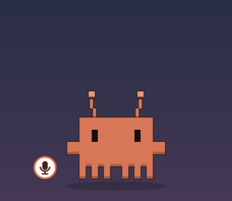

# Klawdy

**Um companheiro de desktop em pixel art para o [Claude Code](https://docs.claude.com/claude-code).**
O Klawdy fica flutuando na tela e mostra o que o Claude está fazendo — trabalhando, precisando de você, pronto —
para você poder tirar o olho do terminal. Ele também traz uma caixa rápida de pedidos (`Ctrl+.`), um menu de
skills, MCPs e conversas anteriores, e comando de voz offline opcional.



> **Projeto não oficial da comunidade.** O Klawdy não é feito, endossado nem suportado pela Anthropic.
> Claude e Claude Code são marcas da Anthropic, PBC.
>
> 🇺🇸 [Read in English](README.en.md)

## Recursos

- **Status num relance** — o Klawdy anda e digita enquanto o Claude trabalha, acena e brilha quando o Claude precisa
  da sua aprovação (com notificação), comemora quando termina e dorme quando fica parado.
- **Ir até a sessão** — clique no Klawdy para trazer o terminal da conversa para frente (GNOME).
- **Sessões com nome** — cada conversa aparece com o título do Claude (ou o nome que você der), e não com o nome da
  pasta. Pelo menu dá para abrir o histórico de qualquer conversa num terminal novo.
- **Caixa `Ctrl+.`** — peça algo sem trocar de janela; mande para uma conversa aberta, uma anterior, um terminal novo
  ou em segundo plano. A resposta aparece num balão (clique para ler tudo; ele some em 30 s).
- **Menu de skills** — todas as suas skills (do Claude Code, do claude.ai, de plugins e de `~/.claude/skills`),
  agrupadas. Enquanto uma skill roda o Klawdy vira **viking**: elmo sempre, espada para skills que constroem/consertam,
  escudo para skills que revisam/protegem.
- **Menu de MCPs** — status de cada servidor, liga/desliga para conversas novas e login nos que precisam.
- **Visual** — temas de cor, fantasias e cenários opcionais, tamanho de 100 a 350 px (rodinha do mouse).
- **Voz (opcional, offline)** — diga "Claudinho, abre a pasta Downloads" ou clique no botão de microfone.
- **Janela de Configurações**, português e inglês, e leve na CPU quando parado.

## Requisitos

| | |
|---|---|
| Sistema | Linux com X11 ou Wayland (no Wayland o Klawdy roda via XWayland) |
| Desktop | **GNOME 45–50**: tudo. **KDE, Xfce e outros**: tudo, menos ir até o terminal da sessão e o atalho `Ctrl+.` automático (dá para criar o atalho para `~/.local/share/klawdy/prompt.sh`) |
| Claude Code | Testado com a **2.1.322** (veja [Compatibilidade](#compatibilidade)) |
| Pacotes | Python ≥ 3.10, PyGObject com GTK 3 e cairo, `jq`, `notify-send` — o instalador instala com apt, dnf, pacman ou zypper |
| Voz (opcional) | PipeWire (`pw-record`) e ~1 GB para os modelos offline |

## Instalação

**Como plugin do Claude Code** (recomendado — os hooks vêm com o plugin):

```
/plugin marketplace add duarles745/klawdy
/plugin install klawdy@klawdy
/klawdy-setup              # acrescente --voice para o comando de voz
```

**Sem o sistema de plugins:**

```bash
git clone https://github.com/duarles745/klawdy.git
bash klawdy/install.sh --manual-hooks          # acrescente --voice para o comando de voz
```

Opções do instalador: `--voice`, `--manual-hooks`, `--terminal-at-login`, `--no-desktop`. Rode de novo quando quiser
atualizar. No GNOME, faça logout e login uma vez para a extensão que foca os terminais ligar. Depois abra uma
sessão **nova** do Claude Code — as que já estavam abertas não recebem os hooks.

Vem do antigo `claude-mascot`/`mascote-desktop`? Instale `klawdy@klawdy`, rode `/klawdy-setup` e
`/plugin uninstall mascote-desktop@mascote`. Configurações, nomes das sessões e modelos de voz são migrados.

## Como usar

| Ação | Faz |
|---|---|
| Arrastar | move o Klawdy (ele lembra o lugar) |
| Clique | vai para o terminal da sessão mais urgente |
| Duplo clique | abre um terminal novo com o Claude Code |
| Rodinha do mouse | muda o tamanho (100–350 px) |
| Botão direito | menu: perguntar, skills, sessões, conversas anteriores, MCPs, aparência, Configurações |
| `Ctrl+.` | caixa de pedidos (arraste pela borda para mudar onde ela abre) |
| Clique no balão de resposta | lê a resposta inteira, copia ou abre a conversa num terminal |
| Botão 🎤 | fala um pedido (com a voz instalada) |
| `/klawdy` | abre o Klawdy de novo se você tiver fechado |

## Comando de voz (opcional)

Instale com `--voice`. Diga **"Claudinho, ⟨pedido⟩"** ou **"Klawdy, ⟨pedido⟩"**, ou clique no 🎤 e fale. Exemplos:
"Claudinho, abre a pasta Downloads", "Claudinho, abre o último PDF que eu baixei".

O reconhecimento é offline (Vosk para a palavra de ativação, faster-whisper para o pedido). O pedido roda com
`claude -p` e uma **lista curta de ferramentas**: listar e abrir arquivos, pastas e sites. Instalar programas baixados
é uma configuração separada, desligada por padrão. Desligando "ouvir o tempo todo", o microfone só abre quando você
clica no botão.

## Segurança e privacidade

- Conversas no terminal continuam pedindo sua aprovação normalmente.
- **Pedidos em segundo plano** (caixa "em segundo plano", conversas anteriores) não têm terminal: quando o Claude
  precisa de permissão (pesquisar na web, rodar um comando, mexer num arquivo…), abre um **popup embaixo do Klawdy**
  com o que ele quer fazer e os botões **Aprovar** / **Recusar**. O popup não pega o teclado sozinho; sem resposta em
  alguns minutos (ou com o Klawdy fechado) o pedido é recusado. Os comandos de voz só usam ferramentas que não
  precisam de aprovação. **O Claude in Chrome vem
  desligado para eles**: uma página pode conter instruções escondidas para o Claude (prompt injection) e ele agiria no
  navegador onde você está logado. Ligar mostra esse aviso antes.
- O Klawdy não envia nada para a internet por conta própria; a voz é reconhecida no seu computador.
- O que ele grava: `~/.config/klawdy` (configurações, nomes, posição), `~/.cache/klawdy` (última resposta, log, lista
  de MCPs, backup diário do `~/.claude.json`), `$XDG_RUNTIME_DIR/klawdy` (estado das sessões, apagado ao desligar),
  `~/.claude/settings.json` (uma variável de ambiente; hooks só com `--manual-hooks`) e o `~/.claude.json` só quando
  você liga/desliga um MCP pelo menu.

## Compatibilidade

Hooks, `claude -p`, `--resume` e `claude mcp list/login` são recursos documentados do Claude Code. Algumas coisas que o
Klawdy mostra **não** são documentadas e foram lidas do Claude Code 2.1.322: o título das conversas dentro dos
transcripts, a lista de MCPs desligados por projeto no `~/.claude.json`, o formato de texto do `claude mcp list` e onde
ficam as skills sincronizadas. Tudo isso está em [`app/klawdy/compat.py`](app/klawdy/compat.py); se uma atualização
mudar algo, só aquele recurso para de funcionar (e o log avisa). Confira em **Configurações › Sobre** ou:

```bash
PYTHONPATH=~/.local/share/klawdy python3 -m klawdy --diagnose
```

## Configurações

Quase tudo está em **botão direito › Configurações**. Fica gravado em `~/.config/klawdy/config.json`:

```json
{ "lang": "auto", "size": 230, "color": "orange", "costume": "none", "scenery": true, "sounds": true,
  "voice": false, "voice_installs": false, "speak": false, "wake_words": [], "chrome": false,
  "terminal": null, "skill_gear": { "deep-research": ["shield"], "debug": ["sword", "shield"] } }
```

`skill_gear` escolhe as peças de cada skill (o elmo vem sempre). `terminal` força um emulador de terminal.

## Problemas comuns

- **O Klawdy não aparece:** rode `~/.local/share/klawdy/klawdy.sh` num terminal e veja o erro.
  `Couldn't find foreign struct converter for 'cairo.Context'` → instale `python3-gi-cairo` (ou o equivalente da sua distro).
- **Não reage ao Claude:** o plugin está ativo (`/plugin`) ou você instalou com `--manual-hooks`? Abriu uma sessão nova
  depois de instalar?
- **O clique diz "Extensão do GNOME inativa":** faça logout/login ou ative "Klawdy" no app Extensões.
- **A voz não entende:** veja `~/.cache/klawdy/voice.log` e confira o microfone padrão nas configurações de som.
- Outros casos: `~/.cache/klawdy/klawdy.log` e `--diagnose`.

## Desinstalar

```bash
bash ~/.claude/plugins/marketplaces/klawdy/uninstall.sh     # ou: bash klawdy/uninstall.sh  (--keep-voice guarda os modelos)
```

e `/plugin uninstall klawdy@klawdy` se usou o plugin.

## Como funciona

```
Claude Code ──hooks──▶ app/hook.sh ──▶ $XDG_RUNTIME_DIR/klawdy/<sessão>.json
                                                    │
     python3 -m klawdy (GTK 3, XWayland) ◀──────────┘   desenha o Klawdy, balões, menus, Configurações
     python -m klawdy.voice (Vosk + Whisper) ──────▶   palavra de ativação → claude -p (ferramentas restritas)
     gnome-extension/klawdy@local ──────────────────▶   foca / digita no terminal da sessão (D-Bus)
```

Cada terminal do Claude Code recebe a etiqueta `[klawdy-xxxxxx]` no título; é por ela que a extensão acha a janela.

## Desenvolvimento

```bash
python3 -m unittest discover -s tests -t .                         # testes (só biblioteca padrão)
pipx run ruff check app tests && shellcheck install.sh uninstall.sh app/*.sh tests/*.sh
docker run --rm -v "$PWD":/src:ro ubuntu:24.04 bash /src/tests/clean_install.sh   # instalação num sistema limpo
python3 tests/make_demo_gif.py pt                                  # regenera a animação do README
```

As traduções ficam em `app/klawdy/strings_en.py` (o texto-fonte é em português); um teste falha se faltar alguma.
O CI roda tudo isso a cada push. Contribuições são bem-vindas — mantenha os padrões de segurança.

## Créditos

Criado por Duarles Moreira. Temas de cor, fantasias e cenários por Alvaro.
As fantasias opcionais são fan art de personagens que pertencem aos seus donos (Mojang/Microsoft, id Software,
Nintendo, The Pokémon Company, Sega, Innersloth, Rockstar Games), sem vínculo com este projeto.

## Licença

[MIT](LICENSE)
